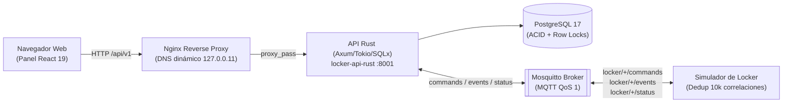
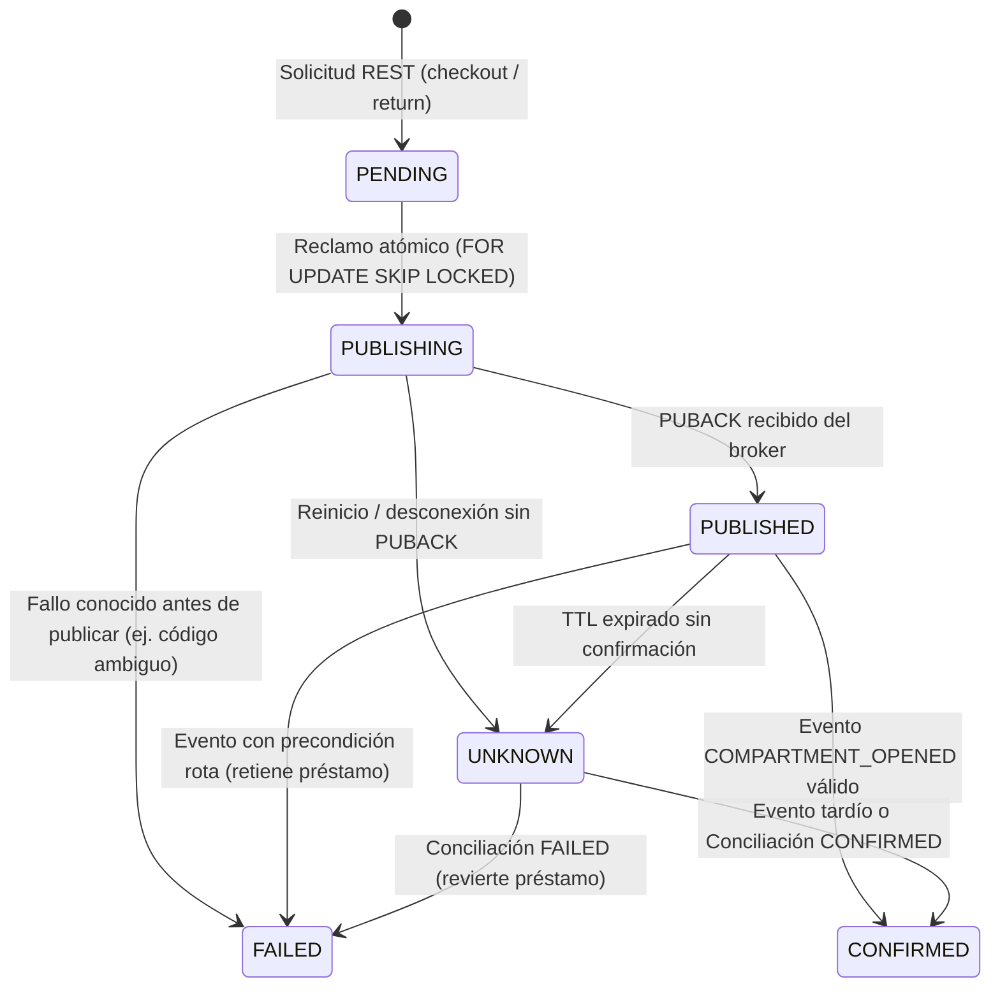

# LOCKER — Electronic Tool Custody & Traceability System

-2ea44f?style=flat-square)


**LOCKER** es un sistema open-source para el control, préstamo, devolución, custodia y trazabilidad de herramientas mediante lockers electrónicos gobernados por **MQTT**.

El backend es un **monolito modular en Rust (Axum + Tokio + SQLx)** con migraciones y semilla (`seed`) integradas en un único binario (`locker-api-rust`), garantías transaccionales estrictas (`FOR UPDATE`), idempotencia, outbox MQTT con recuperación ante caídas, detección de presencia en tiempo real y conciliación administrativa auditable.

---

## Tabla de Contenidos

1. [Arquitectura y Máquina de Estados](#1-arquitectura-y-máquina-de-estados)
2. [Estructura del Repositorio](#2-estructura-del-repositorio)
3. [Requisitos e Inicio Rápido](#3-requisitos-e-inicio-rápido)
4. [Contratos de Dominio, Presencia y Paginación](#4-contratos-de-dominio-presencia-y-paginación)
5. [Rendimiento y Eficiencia](#5-rendimiento-y-eficiencia)
6. [Validación Local (`check-local.ps1`)](#6-validación-local-check-localps1)
7. [Configuración y Variables de Entorno](#7-configuración-y-variables-de-entorno)
8. [Releases y Seguridad](#8-releases-y-seguridad)

---

## 1. Arquitectura y Máquina de Estados

El sistema desacopla el dominio transaccional de la frontera física del hardware mediante un protocolo de mensajería MQTT con correlación explícita (`correlation_id`).



### Ciclo de vida de una operación física

Un `PUBACK` del broker MQTT **jamás** se interpreta como apertura física completada: solo acredita que el broker aceptó el comando. Cuando el resultado físico es incierto (caída de red, reinicio a mitad de vuelo o expiración del TTL), la operación pasa a `UNKNOWN` manteniendo bloqueados los recursos del dominio hasta que un operador la concilie con motivo y evidencia.



---

## 2. Estructura del Repositorio

```text
locker/
├── compose.yaml                  # Stack Docker principal (PostgreSQL, Mosquitto, Rust API, Web, Simulador)
├── .env.example                  # Variables de entorno base
├── CHANGELOG.md                  # Historial de versiones y notas para GitHub Releases
├── docs/hardware/
│   └── HARDWARE_PROTOCOL.md      # Especificación del protocolo MQTT v1 y máquina de estados
├── infra/docker/
│   └── mosquitto.conf            # Configuración del broker Eclipse Mosquitto
├── scripts/
│   └── check-local.ps1           # Suite única de validación local (QUICK / FULL)
└── apps/
    ├── api-rust/                 # Backend Rust (Axum + Tokio + SQLx + migrate/seed + 46 tests)
    ├── web/                      # Frontend React 19 + TypeScript + Nginx + 20 tests Vitest
    └── locker-simulator/         # Simulador MQTT de hardware + 7 tests Pytest
```

---

## 3. Requisitos e Inicio Rápido

### Requisitos
- **Docker Desktop** o **Docker Engine** con Docker Compose.
- **Node.js 22+** para comprobaciones locales del frontend. *(Rust y el simulador se validan dentro de contenedores Linux mediante `scripts/check-local.ps1`, sin requerir toolchain Rust instalado en el host).*
- Puertos TCP locales libres: `8083` (panel web) y `18001` (acceso directo opcional a `api-rust`).

### Levantar el servicio (`127.0.0.1:8083`)

```bash
git clone git@github.com:mateoschreiber/locker.git
cd locker
cp .env.example .env
docker compose up -d --build
docker compose exec api-rust locker-api-rust seed
```

- **Panel web:** `http://127.0.0.1:8083` (credenciales de laboratorio: `admin` / `admin`).
- **Checks de salud:** `http://127.0.0.1:8083/health/live` y `http://127.0.0.1:8083/health/ready` (o directo en `http://127.0.0.1:18001/health/ready`).
- **Subcomandos de `locker-api-rust`:**
  - `locker-api-rust` (sin argumentos): inicia el servidor HTTP y el puente MQTT.
  - `locker-api-rust migrate`: aplica de forma idempotente la migración baseline SQLx (`_sqlx_migrations`); se ejecuta automáticamente al iniciar el contenedor `api-rust`.
  - `locker-api-rust seed`: carga la sucursal `LAB` con 1 locker (`LAB-LOCKER-001`), 24 compartimentos y 24 herramientas; exige `APP_ENV=lab` y rechaza cualquier base que ya contenga datos.

```bash
# Operaciones habituales
docker compose ps
docker compose logs -f api-rust
docker compose down          # Detiene contenedores conservando los volúmenes de datos
```

---

## 4. Contratos de Dominio, Presencia y Paginación

### Contratos de administración e integridad
- **Lista blanca de estados administrativos por entidad:**
  - `ACTIVE` / `INACTIVE`: sucursales, usuarios, membresías y compartimentos.
  - `ONLINE` / `INACTIVE`: lockers.
  - `LOCKED` / `INACTIVE`: cerraduras.
  - `SIMULATED` / `INACTIVE`: cámaras.
  - `AVAILABLE` / `INACTIVE`: herramientas.
  - Cualquier estado desconocido o exclusivo del dominio (`ON_LOAN`) responde `422 Unprocessable Entity`.
- **Guardias de estado activo (`409 Conflict`):**
  - Una herramienta con préstamo activo o pendiente y un compartimento ocupado o reservado por una devolución en curso (`PENDING`, `PUBLISHING`, `PUBLISHED`, `UNKNOWN`) rechazan cambios manuales de estado y desactivación (`PATCH` y `/deactivate`) con bloqueo transaccional `FOR UPDATE`.
  - No se permite crear autorizaciones (`POST /authorizations`) ni ejecutar retiros (`POST /authorizations/{id}/checkout`) cuando la herramienta, usuario, sucursal, locker o compartimento tienen estado `INACTIVE` (`409 "No se puede operar con una entidad inactiva"`).
- **Protección de credenciales:** ninguna respuesta REST incluye jamás el campo `password`.
- **Conciliación (`POST /api/v1/operations/{id}/resolve`):** acepta operaciones `UNKNOWN` y operaciones `FAILED` que aún retienen un préstamo pendiente (`CHECKOUT_PENDING` / `RETURN_PENDING`). Exige `Authorization: Bearer lab-admin-token`, `outcome` (`CONFIRMED` | `FAILED`), `reason` (≤255 caracteres) y `evidence`.

### Presencia MQTT, paginación y carga por vista
- **Presencia observada (`GET /api/v1/lockers/presence`):** consume `locker/{code}/status` en memoria y reporta `ONLINE`, `STALE`, `OFFLINE` o `UNKNOWN` (ver [`docs/hardware/HARDWARE_PROTOCOL.md`](docs/hardware/HARDWARE_PROTOCOL.md)).
- **Paginación (`/{entity}?limit=&offset=`):** con `limit` (`1..=200`) y `offset` (`≥0`), devuelve `{ items, total, limit, offset }` ordenado por `created_at DESC, id DESC`. Sin `limit`, devuelve el array completo.
- **Operaciones enriquecidas (`GET /api/v1/operations?limit=`):** cada fila incluye en una sola consulta `JOIN` `tool_name`, `locker_code`, `compartment_code`, `user_display_name`, `loan_status` y `requires_intervention`. Soporta el filtro `attention=1|0`.
- **Sondeo del panel por vista activa (`apps/web/src/polling.ts`):** el frontend solo sondea los recursos de la vista en pantalla (≤3 peticiones cada 4 s), cachea las tablas de referencia refrescándolas tras cada mutación, pausa el sondeo cuando la pestaña está oculta y aborta peticiones en vuelo al cambiar de vista.

---

## 5. Rendimiento y Eficiencia

| Métrica | Ciclo completo sin paginar | Paginado (`limit=100`) y carga por vista | Mejora |
| :--- | :---: | :---: | :---: |
| **Solicitudes al backend por minuto** | ~245 req/min (16 req / 4 s) | **45–48 req/min** (≤3 req / 4 s) | **−80 %** |
| **Tráfico por ciclo (Dataset base — seed LAB)** | ~31,0 KB | **≤6,1 KB** | **−80 %** |
| **Latencia p95 `/api/v1/audit` (24 000 filas)** | 264,6 ms (6 034,9 KB/resp) | **28,7 ms (25,3 KB/resp)** | **−89 % latencia / −99,6 % bytes** |
| **RAM y CPU de `api-rust` (24 000 filas)** | 80–129 MiB (picos ~22 % CPU) | **5,4–6,2 MiB planos** (≤0,74 % CPU) | **−95 % RAM** |

---

## 6. Validación Local (`check-local.ps1`)

La validación del proyecto se ejecuta desde cualquier directorio de PowerShell:

```powershell
.\scripts\check-local.ps1            # QUICK (por defecto): cargo fmt, clippy -D warnings,
                                     # 13 pruebas unitarias/health Rust, lint/build/20 tests Vitest web
                                     # y git diff --check
.\scripts\check-local.ps1 FULL       # QUICK + 34 pruebas de integración Rust con PostgreSQL y Mosquitto
                                     # desechables, validación de compose.yaml, build de imágenes Docker
                                     # y ruff + 7 tests pytest del simulador
```

Para auditar la integridad relacional de una base existente en modo de solo lectura:

```bash
psql -v ON_ERROR_STOP=1 -f apps/api-rust/integrity.sql
```

---

## 7. Configuración y Variables de Entorno

Copia `.env.example` a `.env` para el entorno local. Nunca incluyas credenciales de producción en el repositorio.

| Variable | Servicio | Valor por defecto (Lab) | Descripción |
| :--- | :--- | :--- | :--- |
| `POSTGRES_DB` / `USER` / `PASSWORD` | `postgres` | `locker_lab` / `locker` / `...` | Credenciales de PostgreSQL para el volumen persistente. |
| `APP_ENV` | `api-rust` | `lab` | Entorno de ejecución (`lab` habilita `locker-api-rust seed`). |
| `LOCKER_BIND_ADDRESS` | `web` | `127.0.0.1` | IP del host donde se publica el puerto `8083` (no usar `0.0.0.0`). |
| `MQTT_HOST` / `MQTT_PORT` | `simulator` | `mosquitto` / `1883` | Host y puerto del broker MQTT interno. |
| `LOCKER_ID` | `locker-simulator` | `LAB-LOCKER-001` | Código de locker que simula el contenedor `locker-simulator`. |
| `RUST_DATABASE_URL` | `api-rust` | `postgresql://...` | Cadena de conexión PostgreSQL para el pool SQLx de Rust. |
| `RUST_BIND_ADDRESS` | `api-rust` | `127.0.0.1:8001` | Socket de escucha del binario Rust (`0.0.0.0:8001` dentro de Docker). |
| `RUST_DB_MAX_CONNECTIONS` | `api-rust` | `5` | Tamaño máximo del pool de conexiones PostgreSQL en Rust (> 0). |
| `RUST_DB_TIMEOUT_SECONDS` | `api-rust` | `3` | Timeout de adquisición y healthcheck SQL en segundos (rango `1..=30`). |
| `RUST_MQTT_ENABLED` | `api-rust` | `true` | Activa el puente MQTT (`false` deja operaciones `PENDING` en tests REST). |
| `RUST_MQTT_HOST` / `PORT` | `api-rust` | `mosquitto` / `1883` | Dirección del broker MQTT para el puente Rust. |
| `RUST_MQTT_CLIENT_ID` | `api-rust` | `locker-api-rust` | Prefijo del `client_id` MQTT (se añade un sufijo UUID por proceso). |
| `RUST_MQTT_CONFIRM_TIMEOUT_SECONDS` | `api-rust` | `60` | TTL tras `PUBACK` antes de marcar la operación como `UNKNOWN` (`1..=600`). |
| `RUST_PRESENCE_STALE_SECONDS` | `api-rust` | `90` | Ventana en segundos antes de degradar la presencia a `STALE` (`30..=600`). |
| `RUST_LOG` | `api-rust` | `info` | Filtro de nivel para logs estructurados JSON (`tracing`). |
| `LOCKER_TEST_DATABASE_URL` | Tests Rust | *(solo tests)* | Base aislada para `cargo test --locked -- --ignored`. |
| `LOCKER_TEST_MQTT_HOST` | Tests Rust | *(solo tests)* | Broker Mosquitto aislado para las pruebas de integración Rust. |

---

## 8. Releases y Seguridad

- **Historial de versiones y notas de lanzamiento:** consulta [`CHANGELOG.md`](CHANGELOG.md) para ver el detalle de cada versión (`v0.1.0` a `v0.5.0`) y las instrucciones para etiquetar y publicar en **GitHub Releases**.
- **Protocolo de Hardware MQTT:** revisa [`docs/hardware/HARDWARE_PROTOCOL.md`](docs/hardware/HARDWARE_PROTOCOL.md).
- **Seguridad y Contribuciones:** consulta [`SECURITY.md`](SECURITY.md) y [`CONTRIBUTING.md`](CONTRIBUTING.md).

> **Aviso de Seguridad de Laboratorio:** Las credenciales `admin` / `admin`, el token de laboratorio y el broker MQTT anónimo sin TLS son exclusivos para desarrollo y simulación local aislada. **No expongas este entorno a Internet ni conectes cerraduras o activos físicos reales** antes de implementar autenticación por sesión, hash de contraseñas y MQTT con TLS/ACL por dispositivo.
