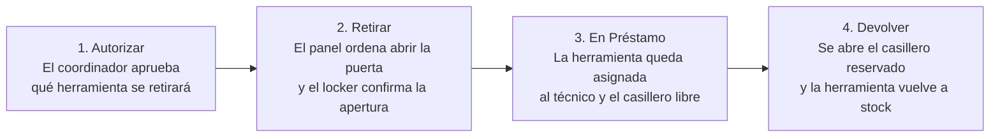
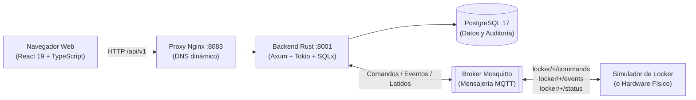

<div align="center">

# ▣ LOCKER

### Custodia Inteligente, Préstamo y Trazabilidad de Herramientas en Tiempo Real

*Un sistema completo para controlar quién retira cada herramienta, en qué compartimento se guarda y cuál es el estado real de cada casillero electrónico.*

[](https://github.com/mateoschreiber/locker/releases)
[](apps/api-rust/)
[](apps/web/)
[](compose.yaml)
[](docs/hardware/HARDWARE_PROTOCOL.md)
[](LICENSE)

[**¿Qué es LOCKER?**](#-qué-es-locker) · [**Cómo Funciona**](#-cómo-funciona-el-flujo-en-4-pasos) · [**Inicio en 60 Segundos**](#-inicio-rápido-en-60-segundos) · [**Recorrido del Panel**](#-recorrido-por-el-panel-web) · [**Arquitectura**](#-arquitectura-del-sistema) · [**Configuración**](#-configuración-y-referencia-técnica)

</div>

---

## 💡 ¿Qué es LOCKER?

En talleres, laboratorios y plantas industriales, el control manual de herramientas suele fallar: **las herramientas se extravían, nadie sabe quién tiene qué equipo o en qué casillero quedó guardado.**

**LOCKER** digitaliza y automatiza ese proceso mediante **casilleros electrónicos (lockers) conectados por red**:

| Problema habitual | Cómo lo resuelve LOCKER |
| :--- | :--- |
| **"¿Quién tiene el taladro y desde cuándo?"** | Cada retiro exige una autorización previa y registra usuario, fecha exacta y compartimento de origen. |
| **"¿En qué casillero está libre un lugar?"** | El panel muestra el mapa visual de los 24 compartimentos de cada locker (`Ocupado`, `Libre` o `Reservado`). |
| **"¿Qué pasa si se corta la red justo al abrir la puerta?"** | El sistema **jamás asume** que una puerta se abrió solo por enviar la orden: espera la confirmación del locker y, si hay duda, marca la operación para revisión humana. |
| **"No tengo el locker físico conectado todavía"** | Incluye un **Simulador de Locker inteligente** que responde en vivo a las órdenes de apertura y envía latidos de conexión cada 30 segundos. |

---

## 🔄 Cómo Funciona el Flujo en 4 Pasos



1. **Solicitud y Aprobación:** Desde el panel se selecciona una herramienta disponible y un usuario activo. Una vez aprobada la autorización, queda lista para el retiro físico.
2. **Apertura Confirmada (Retiro):** Al pulsar **Retirar**, el sistema envía el comando por MQTT al locker. Cuando el locker confirma que la puerta realmente se abrió, el préstamo pasa a **Activo**.
3. **Custodia y Supervisión en Vivo:** Mientras la herramienta está en uso, el panel monitorea la conexión del locker en tiempo real (`ONLINE`, `STALE` o `OFFLINE`).
4. **Devolución (o Conciliación si algo falla):** Al pulsar **Devolver**, el sistema reserva el compartimento para que nadie más lo ocupe, abre la puerta y, tras la confirmación, devuelve la herramienta al inventario disponible.

---

## 🚀 Inicio Rápido en 60 Segundos

Solo necesitas tener **Docker Desktop** abierto. No hace falta instalar Rust, Python ni bases de datos en tu equipo.

### 1. Clonar y levantar el sistema

```bash
git clone git@github.com:mateoschreiber/locker.git
cd locker
cp .env.example .env
docker compose up -d --build
```

### 2. Cargar los datos de demostración (primera vez)

Carga la sucursal `LAB`, el locker `LAB-LOCKER-001` con **24 compartimentos**, **24 herramientas** y **3 usuarios de prueba**:

```bash
docker compose exec api-rust locker-api-rust seed
```

### 3. Entrar al panel

Abre tu navegador en:

> 🌐 **Panel Web:** [`http://127.0.0.1:8083`](http://127.0.0.1:8083)<br/>
> 👤 **Usuario:** `admin`<br/>
> 🔑 **Contraseña:** `admin`

---

## 🖥️ Recorrido por el Panel Web

El panel administrativo está diseñado en español y actualiza únicamente la vista que tienes en pantalla cada 4 segundos (pausando el consumo automáticamente cuando cambias de pestaña en el navegador):

| Vista | Qué puedes hacer en ella |
| :--- | :--- |
| **⌂ Inicio (Dashboard)** | Ver de un vistazo cuántos lockers están activos, herramientas disponibles vs. en préstamo, actividad reciente y alertas si algún locker perdió conexión o alguna operación requiere atención. |
| **↗ Operación** | **Flujo diario:** crear autorizaciones de préstamo y usar los botones directos de **Aprobar**, **Retirar**, **Cancelar** y **Devolver**. |
| **⟳ Operaciones** | Supervisar cada comando enviado al hardware (fechas de solicitud, envío y confirmación física) y **conciliar manualmente** con motivo y evidencia si una puerta quedó en estado incierto (`UNKNOWN`). |
| **▦ Inventario** | Buscar herramientas por código o nombre al instante, ver su código RFID, estado actual y consultar todo su **historial de ubicaciones** casillero por casillero. |
| **▣ Lockers** | Ver el estado de conexión en tiempo real (`ONLINE` / `OFFLINE` / `STALE`) de cada locker y el mapa visual de sus **24 compartimentos** con sus cerraduras. |
| **⚙ Administración** | Dar de alta, editar estados o desactivar sucursales, roles, usuarios, membresías, lockers, compartimentos, cerraduras, cámaras y herramientas (con protección contra desactivar equipos que están en préstamo). |
| **◷ Actividad** | Registro de auditoría completo: quién inició sesión, quién aprobó un retiro, qué confirmó el hardware y qué resoluciones manuales se tomaron. |

---

## ⚡ Por Qué Este Stack Destaca

- **🦀 Backend 100 % en Rust (`Axum + Tokio + SQLx`):** Todo el servidor, el puente de mensajería MQTT, las migraciones de base de datos (`migrate`) y la semilla inicial (`seed`) viven en un único binario compilado ultrarrápido.
- **📉 Consumo Mínimo de Recursos:** Incluso con un historial de **24 000 registros de auditoría**, el backend en Rust consume apenas **~6 MiB de memoria RAM** y responde listados paginados en **~15 ms**.
- **🛡️ Integridad a Prueba de Fallos Físicos:**
  - Bloqueos transaccionales en base de datos para impedir que dos personas retiren la misma herramienta o devuelvan al mismo casillero al mismo tiempo.
  - Si un locker físico o el broker MQTT se desconecta a mitad de una apertura, el préstamo no se pierde ni se libera por error: pasa a estado `UNKNOWN` hasta que un administrador verifique físicamente el casillero.
  - Si una herramienta, usuario o locker es marcado como `INACTIVE`, el sistema bloquea automáticamente cualquier intento de autorización o retiro (`409 Conflict`).

---

## 🏗️ Arquitectura del Sistema



### Estructura de Carpetas

```text
locker/
├── compose.yaml                  # Levanta PostgreSQL, Mosquitto, Rust API, Web y Simulador
├── .env.example                  # Plantilla de configuración rápida
├── CHANGELOG.md                  # Historial de versiones y notas de lanzamiento
├── docs/hardware/
│   └── HARDWARE_PROTOCOL.md      # Protocolo MQTT v1 para conectar lockers físicos
├── infra/docker/
│   └── mosquitto.conf            # Configuración del broker MQTT interno
├── scripts/
│   └── check-local.ps1           # Validador automático en un solo comando (QUICK / FULL)
└── apps/
    ├── api-rust/                 # Backend principal en Rust (API REST + Puente MQTT + 46 tests)
    ├── web/                      # Interfaz web en React 19 + TypeScript (20 tests Vitest)
    └── locker-simulator/         # Simulador inteligente de locker MQTT (7 tests Pytest)
```

---

## 🧪 Comandos Útiles y Validación

### Operación diaria con Docker

```bash
docker compose ps                              # Ver estado de salud de los 5 contenedores
docker compose logs -f api-rust                # Ver logs en vivo del backend Rust
docker compose down                            # Apagar conservando todos los datos guardados
```

### Ejecutar todas las pruebas de calidad (`check-local.ps1`)

Desde PowerShell en Windows puedes validar formato, linter, compilación y las **73 pruebas automatizadas** del proyecto sin instalar nada en tu máquina (usa contenedores temporales y nunca toca tus datos del puerto `8083`):

```powershell
.\scripts\check-local.ps1            # Modo QUICK (~60 s): formato Rust, Clippy, tests unitarios
                                     # Rust, ESLint, compilación web y 20 tests de interfaz React

.\scripts\check-local.ps1 FULL       # Modo FULL: todo lo anterior + 34 tests de integración Rust
                                     # con PostgreSQL y Mosquitto reales + 7 tests del simulador
```

---

## ⚙️ Configuración y Referencia Técnica

<details>
<summary><strong>📂 Haz clic aquí para desplegar todas las Variables de Entorno (.env)</strong></summary>

<br/>

| Variable | Servicio | Valor por defecto (Lab) | Descripción |
| :--- | :--- | :--- | :--- |
| `POSTGRES_DB` / `USER` / `PASSWORD` | `postgres` | `locker_lab` / `locker` / `...` | Credenciales de PostgreSQL para el volumen de datos persistente. |
| `APP_ENV` | `api-rust` | `lab` | Entorno de ejecución (`lab` habilita el comando `locker-api-rust seed`). |
| `LOCKER_BIND_ADDRESS` | `web` | `127.0.0.1` | IP del host donde escucha el puerto `8083` (mantener en `127.0.0.1` o IP LAN privada). |
| `MQTT_HOST` / `MQTT_PORT` | `simulator` | `mosquitto` / `1883` | Host y puerto del broker MQTT interno. |
| `LOCKER_ID` | `locker-simulator` | `LAB-LOCKER-001` | Código del locker que emula el contenedor simulador. |
| `RUST_DATABASE_URL` | `api-rust` | `postgresql://...` | Cadena de conexión PostgreSQL para el pool SQLx de Rust. |
| `RUST_BIND_ADDRESS` | `api-rust` | `127.0.0.1:8001` | Socket del binario Rust (`0.0.0.0:8001` dentro del contenedor Docker). |
| `RUST_DB_MAX_CONNECTIONS` | `api-rust` | `5` | Número máximo de conexiones en el pool de PostgreSQL. |
| `RUST_DB_TIMEOUT_SECONDS` | `api-rust` | `3` | Tiempo máximo de espera de base de datos en segundos (`1..=30`). |
| `RUST_MQTT_ENABLED` | `api-rust` | `true` | Activa el puente MQTT (`false` deja operaciones en `PENDING` para pruebas REST). |
| `RUST_MQTT_HOST` / `PORT` | `api-rust` | `mosquitto` / `1883` | Dirección del broker MQTT al que se conecta el puente Rust. |
| `RUST_MQTT_CLIENT_ID` | `api-rust` | `locker-api-rust` | Prefijo identificador del cliente MQTT. |
| `RUST_MQTT_CONFIRM_TIMEOUT_SECONDS` | `api-rust` | `60` | Segundos tras `PUBACK` antes de marcar una operación sin respuesta como `UNKNOWN` (`1..=600`). |
| `RUST_PRESENCE_STALE_SECONDS` | `api-rust` | `90` | Segundos sin latidos antes de marcar la presencia del locker como `STALE` (`30..=600`). |
| `RUST_LOG` | `api-rust` | `info` | Nivel de detalle de los logs estructurados (`info`, `debug`, `warn`, `error`). |

</details>

<details>
<summary><strong>📂 Haz clic aquí para desplegar los Contratos de la API REST y Máquina de Estados</strong></summary>

<br/>

- **Estados administrativos permitidos por entidad (`422` si se envía otro valor):**
  - `ACTIVE` / `INACTIVE`: sucursales, usuarios, membresías y compartimentos.
  - `ONLINE` / `INACTIVE`: lockers.
  - `LOCKED` / `INACTIVE`: cerraduras.
  - `SIMULATED` / `INACTIVE`: cámaras.
  - `AVAILABLE` / `INACTIVE`: herramientas (`ON_LOAN` lo asigna únicamente la confirmación física de retiro).
- **Paginación opt-in (`GET /api/v1/{entidad}?limit=&offset=`):**
  - Con `limit` (`1..=200`) y `offset` (`≥0`), devuelve `{ "items": [...], "total": N, "limit": N, "offset": N }` ordenado por `created_at DESC, id DESC`. Sin `limit`, devuelve la lista completa.
- **Operaciones enriquecidas (`GET /api/v1/operations?limit=100&attention=1`):**
  - Incluye en una sola consulta `tool_name`, `locker_code`, `compartment_code`, `user_display_name`, `loan_status` y `requires_intervention`.
- **Auditoría de integridad SQL de solo lectura:**
  - Puedes verificar invariantes sobre cualquier base con `psql -v ON_ERROR_STOP=1 -f apps/api-rust/integrity.sql`.

</details>

---

## 📦 Releases, Documentación y Seguridad

- **Notas de versión (`v0.1.0` → `v0.5.0`):** consulta [`CHANGELOG.md`](CHANGELOG.md) y la sección de [**GitHub Releases**](https://github.com/mateoschreiber/locker/releases).
- **Protocolo de Hardware MQTT v1:** consulta [`docs/hardware/HARDWARE_PROTOCOL.md`](docs/hardware/HARDWARE_PROTOCOL.md) para integrar controladores físicos reales (ESP32, PLC o Raspberry Pi).
- **Política de Seguridad y Contribuciones:** consulta [`SECURITY.md`](SECURITY.md), [`CONTRIBUTING.md`](CONTRIBUTING.md) y [`CODE_OF_CONDUCT.md`](CODE_OF_CONDUCT.md).

> ⚠️ **Nota de Seguridad (Modo Laboratorio):** Las credenciales predeterminadas (`admin` / `admin`) y el broker MQTT local sin TLS están pensados para evaluación, desarrollo y simulación en red aislada. Antes de pasar a producción con cerraduras físicas reales o exponer el sistema fuera de tu red local, deben configurarse sesiones autenticadas, contraseñas con hash y certificados TLS por dispositivo.
